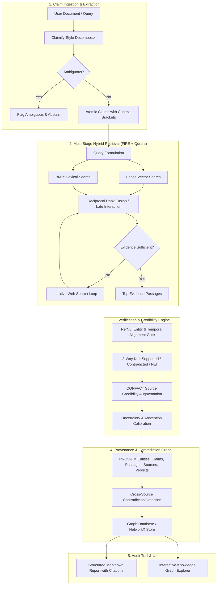

# ProofGraph: Autonomous AI Evidence Intelligence & Claim Verification Engine

ProofGraph is an autonomous evidence intelligence platform designed to ingest complex multi-claim documents or questions, decompose them into atomic verifiable propositions, retrieve high-precision evidence using a hybrid multi-stage retrieval pipeline, rigorously verify claims using NLI and context validation, model claim-evidence relationships as a W3C PROV-DM knowledge graph with first-class contradiction links, and generate auditable research reports with calibrated uncertainty.

---

## 1. Deep Research & Critique of Prior Systems

To ensure ProofGraph is superior to existing systems, we analyzed the source code, technical reports, and empirical benchmarks of key prior implementations. Below is a summary of their architectural designs, critical failure modes, and how ProofGraph solves them.

| System / Paper | Core Architecture | Key Strengths | Fatal Flaws & Failure Modes | ProofGraph Solution |
| :--- | :--- | :--- | :--- | :--- |
| **TRUSTGRAPH** (GitHub) | Streamlit + Plotly + NetworkX in a single Jupyter Notebook. | Visual graph UI linking a central claim node to sources. | **100% Mock Demo**: Hardcoded 6 news sources, naive regex claim splitting, zero real web search, no NLI, no true provenance or ontology. | Production FastAPI backend, real hybrid retrieval, W3C PROV-DM schema, and true NLI-driven edge generation. |
| **FIRE** (NAACL 2025) | Iterative retrieval agent with unified decision module (stops or queries). | **7.6x LLM cost reduction, 16.5x search reduction** over fixed-$N$ systems. | No knowledge graph; no source credibility weighting; vulnerable to prompt injection in retrieved snippets. | Adopt FIRE's dynamic stopping policy, but wrap it in an isolated Quarantined LLM with source credibility scoring. |
| **LOKI / OpenFact** (COLING 2025) | 5-step pipeline: Check-worthy $\to$ Query $\to$ Serper search $\to$ NLI $\to$ Report. | Full-pipeline orchestration; open-source release. | **Brittle Output Parsing**: Open models (LLaMA-3) frequently fail structured JSON; no graph relationships or contradiction tracing. | Enforce schema validation via Pydantic + constrained decoding (XGrammar/Outlines); model contradictions as first-class graph edges. |
| **Veracity** (IJCAI 2025) | Next.js + FastAPI + PostgreSQL + GCP. | Clean full-stack production architecture; pre-curated media credibility DB. | Coarse document-level checks; no atomic claim decomposition; ignores prompt injection vectors. | Fine-grained atomic decomposition (Claimify-style) with interactive Graph visualizer and Dual-LLM security boundary. |
| **Hybrid KG+LLM** (arXiv 2511.03217) | 1-hop DBpedia SPARQL $\to$ MiniLM cross-encoder rerank $\to$ Web fallback if NEI. | 0.93 F1 on FEVER; deterministic triple paths eliminate hallucinated evidence. | KG coverage limited to single-hop encyclopedic entities; fails on contemporary political claims. | Tiered architecture: Fast local KG/vector store first pass $\to$ iterative web retrieval fallback with source credibility weighting. |
| **SANCTUARY** (AVeriTeC 2025, 3rd) | Qwen2.5 HyDE query generation $\to$ coarse BM25 $\to$ fine semantic chunking $\to$ Phi-4 CoT. | Reproducible, fits on 24GB VRAM GPU; executes in 31.7s per claim. | Cannot handle multi-hop background investigations without iterative loops; lacks visual graph output. | Hybrid dense+sparse retrieval pipeline inspired by SANCTUARY, extended with iterative retrieval and graph provenance. |

---

## 2. Critical Research Negative Results to Guard Against

1. **The Decomposition Dilemma (arXiv:2411.02400):** Over-fragmenting claims hurts strong verifiers by accumulating retrieval noise and omitting context ($E_d + E_r > \Delta A$).
   * *Rule:* Never decompose concise or single-sentence claims. For long texts, constrain sub-claims $N_{\text{sub-claims}} \le N_{\text{sentences}}$, and run decontextualization to resolve pronouns before search.
2. **NLI Context Mismatch / Reference Indeterminacy (RefNLI, arXiv:2502.05793):** Off-the-shelf NLI models predict **>80% false contradictions** when evidence discusses a different entity or time period because they falsely assume the premise and hypothesis share the same context.
   * *Rule:* Enforce an Entity & Temporal Alignment filter (Jaccard similarity $> 0.15$ + Named Entity Overlap) before passing premise-hypothesis pairs to NLI models.
3. **The Majority-Vote Trap in Conflicting Evidence (CONFACT, arXiv:2505.17762):** Three unreliable blogs will outvote one authoritative debunk under vanilla RAG. Filtering sources at retrieval stage *hurts* accuracy by removing necessary debunk context.
   * *Rule:* Augment retrieved evidence with source credibility metadata at the **generation/verification stage**, rather than filtering at retrieval.
4. **Prompt Injection from Untrusted Web Pages (OWASP LLM01:2025):** 5 poisoned documents can hijack RAG outputs 90% of the time.
   * *Rule:* Implement the **Dual LLM Pattern**: A Quarantined LLM reads raw untrusted web content and outputs structured JSON extractions; a Privileged LLM reasons over trusted internal templates and structured extractions.

---

## 3. Core Architectural Components

---

## 4. 10-Day Step-by-Step Collaborative Milestone Plan

### Milestone 1 (Days 1–2): Foundational Literature & Architecture Alignment
* **User Focus:** Read key papers (Claimify, CONFACT, RefNLI, W3C PROV-DM) and finalize core design decisions:
  * Decision 1: Primary evaluation benchmark (AVeriTeC vs. SciFact vs. FEVER).
  * Decision 2: Local vector store & graph store technology choice (Qdrant vs. ChromaDB; NetworkX vs. Neo4j).
  * Decision 3: LLM backend (OpenAI/Anthropic APIs vs. local vLLM/Ollama).
* **Agent Focus:** Initialize repository scaffolding (`proofgraph/`), setup virtual environment, configure test harnesses, and build evaluation baseline scripts.

### Milestone 2 (Days 3–4): Atomic Claim Decomposition & Decontextualization Engine
* **User Focus:** Review extracted claim samples across edge cases (ambiguous pronouns, conditional statements, numerical claims).
* **Agent Focus:**
  * Implement Claimify 4-stage pipeline: sentence splitting $\to$ verifiability filtering $\to$ ambiguity detection $\to$ bracketed contextual proposition extraction.
  * Integrate DecMetrics (Completeness, Correctness) test suite.
  * Implement check-worthiness filtering (ClaimBuster style).

### Milestone 3 (Days 5–6): Hybrid Multi-Stage Retrieval & FIRE Iterative Loop
* **User Focus:** Evaluate retrieval quality (Recall@k, precision) on sample claims; review search query strategies.
* **Agent Focus:**
  * Build hybrid indexing pipeline (Dense embeddings + BM25 sparse lexical search).
  * Implement ColBERT late-interaction / RRF rank fusion.
  * Build the FIRE iterative retrieval loop with dynamic early stopping and diversity prompts.
  * Add live web search connectors (Serper / Tavily / Google API) with strict temporal cutoff enforcement.

### Milestone 4 (Day 7): Verification, NLI, and Source Credibility Layer
* **User Focus:** Inspect contradiction classifications and source credibility scoring weights.
* **Agent Focus:**
  * Implement RefNLI pre-filter (Entity overlap & Jaccard threshold $> 0.15$) to prevent false contradictions.
  * Build 3-way NLI classifier (Supported, Contradicted, Not Enough Evidence).
  * Implement CONFACT source credibility augmentation ($SBA_{\text{CoT}}$) using media credibility datasets (MBFC / NewsGuard style).
  * Implement calibrated abstention logic for low-confidence or conflicting inputs.

### Milestone 5 (Day 8): W3C PROV-DM Graph Modeling & Contradiction Edges
* **User Focus:** Review the graph ontology and verify that evidence provenance meets audit standards.
* **Agent Focus:**
  * Implement W3C PROV-DM data model: Entities (Claims, Passages, Sources), Activities (Decompose, Retrieve, Verify), Agents (Models, Scrapers).
  * Implement first-class **Contradiction Edges** connecting conflicting claims or contradictory sources.
  * Export graph serializations (JSON-LD, NetworkX, PROV-N).

### Milestone 6 (Day 9): Interactive Visualizer & Report Generation
* **User Focus:** Test end-to-end user experience with custom research documents.
* **Agent Focus:**
  * Build interactive graph visualization UI (Cytoscape.js / D3 / React Flow or Streamlit/FastAPI).
  * Implement structured audit report generator with inline evidence citations, uncertainty scores, and source breakdowns.
  * Implement Dual-LLM prompt injection sanitization boundary for untrusted web inputs.

### Milestone 7 (Day 10): End-to-End Evaluation, Ablation Benchmarking & Polish
* **User Focus:** Review benchmark metrics (Precision, Recall, Macro-F1, Ev2R) against standard RAG baselines.
* **Agent Focus:**
  * Run comparative ablation study:
    1. Baseline 1: Standard RAG (single prompt + web search).
    2. Baseline 2: Decomposition + Retrieval + NLI (no graph/credibility).
    3. ProofGraph Full: Decompose + Hybrid Retrieval + RefNLI + Credibility + Contradiction Graph.
  * Finalize code documentation, architecture diagrams, and submission demo recording.

---

## 5. Verification & Testing Plan

### Automated Benchmarks
* **AVeriTeC Subsplit Test:** Run evaluation against 100 held-out real-world claims using Macro-F1 and Ev2R evidence recall.
* **RefNLI Stress Test:** Evaluate on 100 context-mismatched entity pairs to verify that false contradictions remain $< 5\%$.
* **CONFACT Conflicting Evidence Test:** Benchmark against 50 conflicting-evidence claims to verify that source credibility weighting outperforms unweighted majority voting.

### Manual & Qualitative Verification
* Test on contemporary ambiguous news claims, multi-sentence research summaries, and adversarial documents with planted prompt injections.
