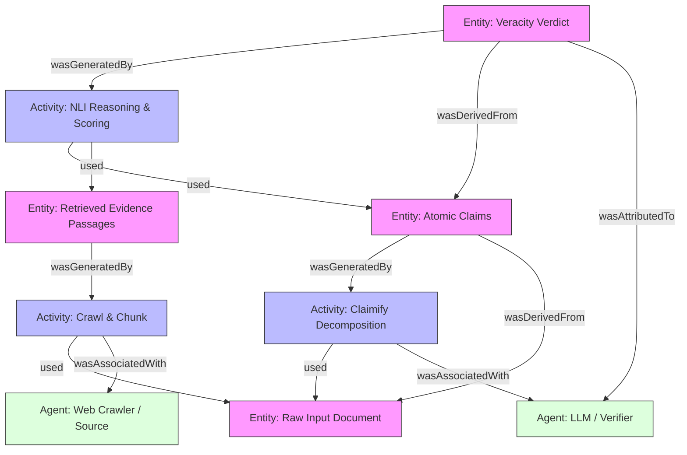

# Core Technical Patterns & Engineering Blueprints

This document compiles the concrete architectural blueprints, vector schemas, NLI mitigation logic, and graph ontology models utilized in ProofGraph.

---

## 1. Hybrid Retrieval: Dense + Sparse + ColBERT Late Interaction
* **Implementation Reference:** Qdrant Hybrid Search & ColBERT Reranking

### Schema & Two-Stage Prefetch Pattern
```python
from qdrant_client.models import (
    Distance, VectorParams, MultiVectorConfig, 
    MultiVectorComparator, HnswConfigDiff, 
    TextIndexParams, TextIndexType, SnowballParams, 
    Snowball, SnowballLanguage, Language
)

client.create_collection(
    collection_name="proofgraph_evidence",
    vectors_config={
        # Stage 1a: Dense semantic embedding (e.g., all-MiniLM-L6-v2)
        "dense": VectorParams(size=384, distance=Distance.COSINE),
        # Stage 2: Late-interaction multivector (ColBERT small)
        "multi": VectorParams(
            size=96,
            distance=Distance.COSINE,
            multivector_config=MultiVectorConfig(comparator=MultiVectorComparator.MAX_SIM),
            hnsw_config=HnswConfigDiff(m=0),  # CRITICAL: Disable HNSW to prevent memory bloat
        ),
    },
)

# Stage 1b: Full-text payload index with BM25 scoring
client.create_payload_index(
    collection_name="proofgraph_evidence",
    field_name="text_content",
    field_schema=TextIndexParams(
        type=TextIndexType.TEXT,
        stemmer=SnowballParams(type=Snowball.SNOWBALL, language=SnowballLanguage.ENGLISH),
        stopwords=Language.ENGLISH,
        scoring=True,  # Enables BM25 frequency/saturation scoring
    ),
)
```

### Why Late Interaction Beats Standard RRF
Standard Reciprocal Rank Fusion (RRF) sums reciprocal ranks equally: $\text{Score}(d) = \sum_m \frac{1}{60 + r_m(d)}$. Irrelevant documents with accidental keyword matches frequently outscore semantically deep documents. ColBERT computes token-to-token MaxSim: $\sum_{q_i \in Q} \max_{d_j \in D} (q_i \cdot d_j)$, preserving multi-word semantic alignment.

---

## 2. Claimify: 4-Stage Atomic Claim Extraction
* **Reference:** Metropolitansky & Larson, Microsoft Research, ACL 2025

### 4-Stage Extraction Pipeline
1. **Stage 1: Sentence Splitting & Context Construction:**
   - Paragraph split and sentence tokenization.
   - Builds context windows including preceding sentences and document section header paths.
2. **Stage 2: Selection (Verifiability Filter):**
   - Filters out opinions, recommendations, and purely subjective prose before expensive downstream processing.
3. **Stage 3: Disambiguation (The Crucial Innovation):**
   - Evaluates whether an independent panel would reach consensus on the referents.
   - If ambiguous, explicitly labels: `Cannot be disambiguated` and **DROPS** the sentence. Dropping 3-5% of ambiguous sentences prevents hallucinated fact-checking loops.
4. **Stage 4: Decomposition & Bracketed Context Flagging:**
   - Decomposes into self-contained atomic claims.
   - Context inferred from document context is enclosed in brackets: `[...]`, e.g., *"John [a senior minister] has called for peace [in the region]."*

---

## 3. RefNLI: Guarding Against the Context Mismatch Trap
* **Reference:** arXiv:2502.05793 (February 2025)

### The Reference Determinacy Failure
Standard NLI models (RoBERTa-MNLI, DeBERTa, T5) are trained under the assumption that Premise ($P$) and Hypothesis ($H$) describe the same entity in the same universe.
* When web search retrieves a passage about *Person B born in 1980*, and the claim is about *Person A born in 1995*:
  - Ground Truth Veracity: **Neutral / Irrelevant** (Premise does not discuss Person A).
  - Out-of-the-Box NLI Prediction: **Contradiction!** (>80% false contradiction rate on irrelevant web pages!).
* **ProofGraph Mitigation:**
  - Enforce an Entity & Temporal Alignment Gate before calling NLI models.
  - Require named entity match or token-level Jaccard overlap:
    $$J(P, H) = \frac{|P \cap H|}{|P \cup H|} > 0.15$$
  - Pairs below the threshold are classified as `Neutral / Insufficient Evidence` without invoking the verifier.

---

## 4. W3C PROV-DM Data Model
* **Standard:** W3C Recommendation (https://www.w3.org/TR/prov-dm/)

ProofGraph implements an auditable provenance graph matching W3C PROV-DM specifications:



---

## 5. First-Class Contradiction Graph Modeling
Unlike prior systems that output scalar verdicts, ProofGraph creates explicit **Contradiction Edges**:
* `CONTRADICTS(Claim_A, Evidence_B)`: When evidence refutes an atomic claim.
* `DISAGREES_WITH(Source_X, Source_Y)`: When two independent sources assert opposing facts about the same entity.
* `SUB_CLAIM_OF(Claim_Atom, Parent_Claim)`: Tracks decomposition hierarchy.
* `UNCERTAINTY_FLAG(Claim_Atom)`: Calibrated confidence score and reason for abstention.
